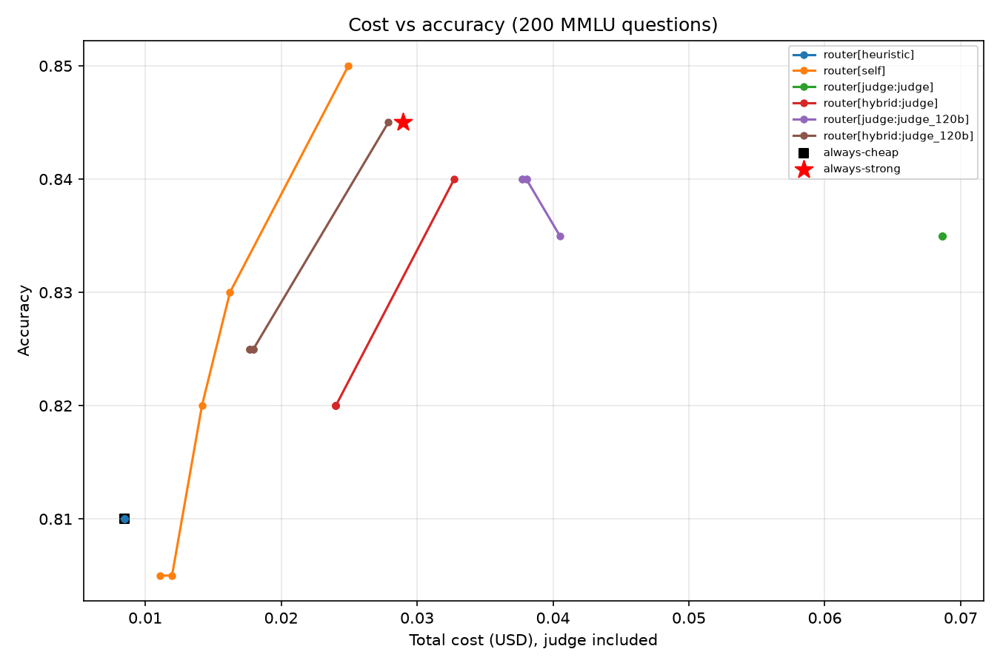
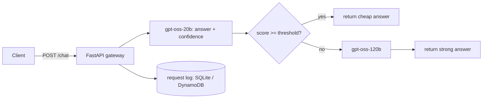
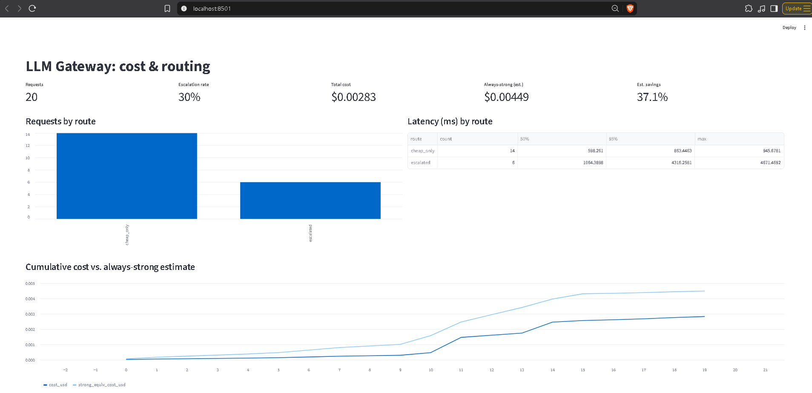
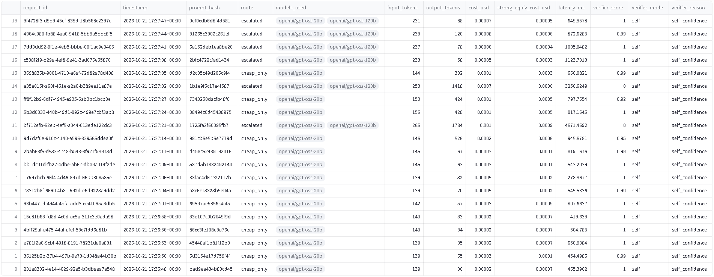
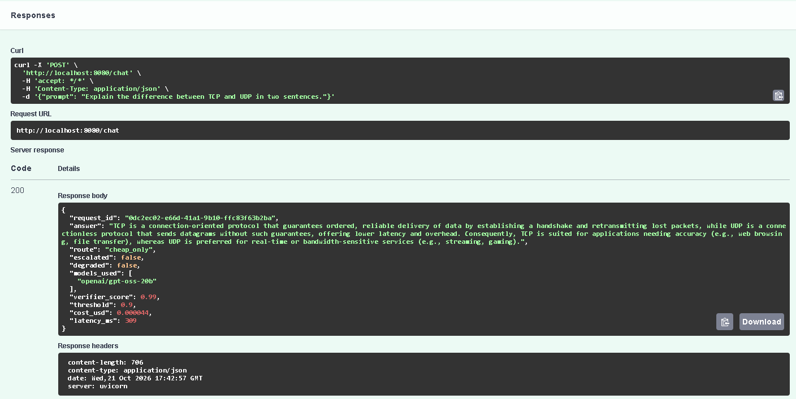
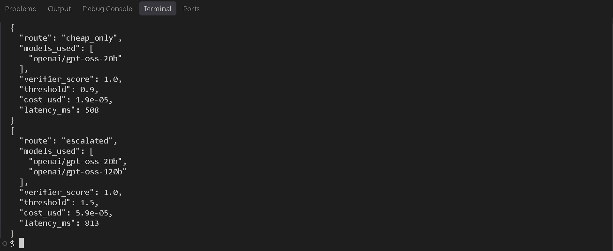

# LLM Gateway: cost-aware model routing

A FastAPI gateway that answers with a cheap model (`gpt-oss-20b`), checks the answer with a verifier, and escalates to a stronger model (`gpt-oss-120b`) only when the verifier isn't confident. Every request is logged (route, tokens, cost, latency), and a Streamlit dashboard shows spend and routing.

**Result (200 MMLU questions, all costs counted, including the verifier):** routing on the cheap model's own confidence cut cost by **44%** versus always using the strong model while keeping **98.2%** of its accuracy (83.0% vs 84.5%). Using an LLM judge to verify answers cost _more_ than not routing at all.



## Results

Setup: 200 random MMLU questions (seed 42), temperature 0, Groq list prices at test time. Cost reduction is measured against always-strong and **includes every call the router makes** (cheap answer + judge, when used + strong answer, when escalated).

| Setup                                                             | Cost    | Accuracy | Cost reduction | Quality retained | Escalated | p50 / p95 latency |
| ----------------------------------------------------------------- | ------- | -------- | -------------- | ---------------- | --------- | ----------------- |
| always-strong (gpt-oss-120b)                                      | $0.0290 | 84.5%    | n/a            | 100%             | n/a       | 754 / 1500 ms     |
| always-cheap (gpt-oss-20b)                                        | $0.0085 | 81.0%    | 70.8%          | 95.9%            | 0%        | 533 / 933 ms      |
| **router, self-confidence t=0.90**                                | $0.0162 | 83.0%    | **44.0%**      | **98.2%**        | 19%       | 550 / 1825 ms     |
| router, self-confidence t=0.80                                    | $0.0142 | 82.0%    | 51.1%          | 97.0%            | 12%       | 542 / 1621 ms     |
| router, self-confidence t=0.95                                    | $0.0249 | 85.0%    | 13.9%          | 100.6%           | 42%       | 615 / 2125 ms     |
| router, judge only on low-confidence answers (gpt-oss-120b judge) | $0.0177 | 82.5%    | 39.0%          | 97.6%            | 6%        | 550 / 1953 ms     |
| router, judge on every request (gpt-oss-120b judge)               | $0.0377 | 84.0%    | -30.3%         | 99.4%            | 12%       | 1150 / 2497 ms    |
| router, judge on every request (Qwen3.8-27B judge)                | $0.0687 | 83.5%    | -137%          | 98.8%            | 15%       | 741 / 2085 ms     |

### Findings

- **The free verifier won.** Self-reported confidence (the cheap model appends a `CONFIDENCE:` score in the same call) costs nothing extra and sits on the cost/accuracy frontier. Every judge-based variant was to its right and below it.
- **LLM judges separated right from wrong answers well but cost too much.** Mean judge score was 0.96 on correct answers and 0.56 on wrong ones (gpt-oss-120b judge), versus 0.95 and 0.88 for self-confidence. But a judge call costs $0.000112 (120b) or $0.000268 (Qwen) against about $0.000145 for a strong answer, so verifying nearly everything costs more than answering with the strong model.
- **Routing trades tail latency for cost.** At t=0.90 the median is 27% faster than always-strong, but p95 is 22% slower, because escalated requests pay for two calls.
- **Always-cheap is a strong baseline here.** It saves 71% at 96% quality. The router is a dial: use t=0.90 when you need at least 98% of the strong model's accuracy.

## How it works



- **Verifier modes** (`config.yaml`): `heuristic` (empty / truncated / refusal checks), `self` (model confidence), `judge` (separate grader model), `hybrid` (judge only when confidence is below a gate). Heuristic failures always escalate.
- **Failure handling:** unparseable judge output scores 0 and escalates; if the strong model is unavailable, the gateway serves the cheap answer and marks the response `degraded`.
- **Logging:** every request stores route, models used, tokens, cost, latency, verifier score and reason (prompt hash only, never the prompt). Backend is SQLite locally or DynamoDB (`LOG_BACKEND`).
- **Benchmark design:** cheap, strong and judge outputs are cached once, then every verifier, judge and threshold is simulated offline, so the sweep costs no extra API calls.

## Screenshots


_Live dashboard over the gateway's request log. This capture is 20 demo requests (16 ordinary prompts plus 4 forced escalations), so its savings figure is not the benchmark result. See Results above._


_Every request is logged with route, models used, tokens, cost, latency and verifier score. Demo traffic: 16 ordinary prompts plus 4 forced escalations (threshold 1.5). The dashboard's savings figure is an estimate on this tiny sample, not the benchmark result._


_FastAPI's built-in docs page: one request answered by the cheap model in 309 ms for $0.000044._


_Same prompt, two routes: the default threshold stays on gpt-oss-20b, a threshold of 1.5 forces escalation to gpt-oss-120b._

## Run locally

```bash
python -m venv .venv && source .venv/bin/activate      # Windows Git Bash: .venv/Scripts/activate
pip install -r requirements.txt
cp .env.example .env                                   # add your GROQ_API_KEY
python -m uvicorn app.main:app --port 8080
curl -s localhost:8080/chat -H 'Content-Type: application/json' \
     -d '{"prompt":"What is the capital of France?"}'
python -m streamlit run dashboard.py                   # dashboard
```

Per-request `threshold` overrides the default; a value above 1 forces the strong model.

Docker: `docker build -t llm-gateway . && docker run --rm -p 8080:8080 --env-file .env llm-gateway`

## Reproduce the benchmark

```bash
python benchmark/run_benchmark.py --n 200 --seed 42    # cheap + strong answers
python benchmark/run_judges.py --role judge            # Qwen judge
python benchmark/run_judges.py --role judge_120b       # gpt-oss-120b judge
python benchmark/analyze.py                            # table + plot
```

The raw results are in `results/`, so `analyze.py` reproduces the table without any API calls.

## What broke along the way

- **My first prompt silently broke the confidence signal.** It told the model to reply with only the answer letter, which conflicted with the confidence instruction, so about a quarter of answers had no confidence and were escalated by default. This made the router look far worse than it was until I checked the missing-confidence count.
- **The "obvious" design lost money.** My first benchmark used the strongest-looking judge (Qwen) on every request and cost 2.4x more than always-strong. Fixing it meant changing the verifier, not tuning thresholds.
- **Judge scores were nearly binary,** so thresholds from 0.5 to 0.9 gave identical results.
- **Rate limits skewed latency and halted runs.** Retry sleeps inflated latency numbers (fixed by timing only the successful attempt), and free-tier daily token caps stopped the benchmark mid-run, so it was split into resumable passes.

## Limitations

- One benchmark (MMLU multiple choice), 200 questions: the 95% interval on accuracy is roughly ±5 points, and a 1.5-point gap is 3 questions.
- The threshold was chosen on the same 200 questions, so the reported saving is somewhat optimistic.
- The price gap between models is small (the strong model costs about 2x per token, 3.4x per query because it reasons longer), which caps the savings. A larger gap would save much more.
- Self-confidence is a weak signal (the model is overconfident); it wins because it is free, not because it is accurate.
- A missing `CONFIDENCE:` line scores 0 and escalates (safe, but costs money): 11 of 200 benchmark answers had none.
- Multiple-choice answers are easy to verify; open-ended generation would need a different verifier.

## Layout

```
app/         gateway (FastAPI), router, verifier, LLM client, request log
benchmark/   run_benchmark.py, run_judges.py, analyze.py
results/     raw benchmark outputs, summary.csv, cost_vs_accuracy.png
dashboard.py Streamlit dashboard
config.yaml  models, prices, verifier mode, thresholds
```
